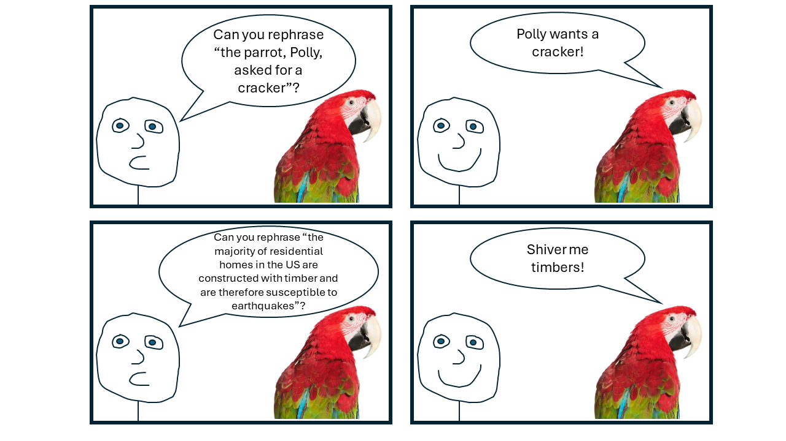

# TL;DR 

The USMR AI policy is very simple:  

> "Don’t use anyone, or anything, else to do your thinking for you".

We have put it this way because it’s exactly the same as the pre-AI policy, just with "anything" added.

# A little more of an explanation

💻 Pre-AI it was fine to ask friends, colleagues, or teachers for help, within limits.

You could for example ask them to look over something you'd done and see whether it seemed right to them. Or you could ask for help with a specific task ("what's the command for a t-test again?" or "how do I get the bars on this graph to go red?") or concept ("have I got it right if I say that the squares in variance are just to remove the pluses and minuses?"). None of these would be considered cheating. If on the other hand you asked a friend "what's the answer to question 3?", "how should I interpret this coefficient?", or "can I copy from your introduction?", we think you know that you would be cheating, because you would be using that friend to do your thinking.

✨ The rules are all exactly the same for AI.

It’s OK to ask an AI how to change the colours of a bar chart, etc.; it's not OK to ask an AI to answer question 3 or to write some of your homework for you (so you can "copy" or "rephrase" it). If you know it would be cheating to ask a friend to do it, you know it would be cheating to ask AI to do it.

🤖 If you use someone or something else to do your thinking, you won't learn.

If you don't learn, it's not really clear to us why you're taking an MSc in Psychology. We spend a lot of effort trying to provide everything you need to learn, and so we take a dim view of cheating, and we will normally interview students that we suspect of cheating (whether copying a friend or using AI) with a view to reducing their marks or, in serious cases, reporting them to the College.

📝 Required Acknowledgment

For any assessment where you used an AI tool, you must include a short statement at the end of your submission detailing how you used it.

**Example 1:** "I used ChatGPT to help me debug an error message in my ggplot code."  
**Example 2:** "I did not use any AI tools for this assessment."  
**Example 3:** "I used Claude to create a function to turn my summary statistics into a nice table (lines X-XX of my code)."  
**Example 4:** "I used ELM to rephrase some of my sentences (those indicated with superscript $^*$ in my report)."  

This acknowledgment is required for full credit and promotes transparency in your learning process.

# Example Use-Cases

Below you can find a traffic light system in an attempt to explain what uses of AI we consider to be 'cheating' on the PG statistics courses in the Psychology department at Edinburgh University. 

Please be very careful and regularly reflect on your usage of AI. The use-cases below that are 'not-permitted' are primarily those that avoid the deliberate, careful, deep thinking that we would like *you* to engage with during your time at university.  

::: {.callout-tip collapse="true"}
## Some things to keep in mind

- AI doesn't **know** anything
- AI doesn't **understand** anything
- AI is essentially a parrot, who has heard *a lot* of words. It will repeat back to us the words it has heard most frequently in a given context. It is auto-complete on steroids.^[See <https://thebullshitmachines.com/>!]
- use of AI in academic work is not defined only by what prompt you give it. It is also about how you use the output.
- Beware of "cognitive offloading"! Whatever you get AI to do for you is something that you won't learn how to do yourself.
- Outsourcing independent thought misses the very point of attending university.

:::

If you have questions about a specific use of AI (the list below is not exhaustive), then we would love for you to contact us. Just email [ppls.psych.stats@ed.ac.uk](mailto:ppls.psych.stats@ed.ac.uk){target="_blank"}.  

::: {.callout-note collapse="true"}
#### Use-Case 1: learning & concept explanation outside of assessments

This use-case refers to situations in which you are asking AI to explain a statistical concept or method to you, _without_ providing context of an assignment, or asking a general coding question. 

Usage of AI involving questions that are not specifically placed in the context of any assignments is similar to referring to textbooks, google, R documentation, or a dictionary. As this is primarily for *learning*, and not directly linked to completing an assignment, none of the output generated by AI under this usage will end up in a submitted piece of work. 

We would like to emphasise three key points:  

- There is an [environmental cost to using AI](https://www.bbc.co.uk/programmes/w3ct6vz4){target="_blank"}. 
- When learning, it is often impossible to verify that the information AI produces in response is valid or correct. 
- There are many many textbooks, blog posts, and online tutorials covering statistical methods. These resources provide a source of knowledge that has been carefully curated, providing you with a much lower chance of being given incorrect information.  

**STATUS:** Proceed with caution  
**IN YOUR AI STATEMENT:** There is no requirement to reference AI or acknowledge this form of use, on the condition that none of output generated is copied or rewritten into an assignment, nor does it *directly* inform decisions taken as part of an assignment.  

:::{.exs}
__Examples__ 

  <small style="font-size:.8em">Ask anything...</small> 
  What does the r squared bit of a linear model mean?

  <small style="font-size:.8em">Ask anything...</small> 
  How do you put plots side by side in R?

:::

:::

::: {.callout-note collapse="true"}
#### Use-Case 2: grammar & formatting

This use-case refers to using AI to check spelling, punctuation, basic grammar or code indentation/formatting.  

The key condition of this use-case is that the meaning of the words (or the functionality of the code) is entirely your own.  

- Be careful not to let AI tools like Grammarly rewrite paragraphs or change the meaning. 
- If you copy your work (or sections of) into a large language model, and ask it to "check for typos", it will very often also change the meaning, or suggest different structures or decisions. This would then constitute as use-cases 6-8.  

**STATUS:** Proceed with caution  
**IN YOUR AI STATEMENT:** No specific in-text referencing is needed, but you should acknowledge the tools used (and how you used them) in your AI statement.  

:::

::: {.callout-note collapse="true"}
#### Use-Case 3: syntax & bug fixing

This use-case refers to asking AI to explain an R error message or fix typos in code you wrote.

Caution - AI will often provide you with an explanation for why your code isn't running and at the same time provide "fixed code" in the response. Avoid copying this into your own code, as this would change the use to 'generating code' (see below).  

**STATUS:** Proceed with caution  
**IN YOUR AI STATEMENT:** No specific in-text referencing is needed, but you should acknowledge the tools used (and how you used them) in your AI statement.  

:::{.exs}
__Examples__ 

  <small style="font-size:.8em">Ask anything...</small> 
  what does this R error mean?  
  argument is not numeric or logical: returning NA

  <small style="font-size:.8em">Ask anything...</small> 
  Why doesn't this code run? 
  ggplot(iris,aes(x=Species,y=Sepal.Length)+ 
  geom_violin()+ 
  labs(x="IRIS SPECIES",y="sepal length")+ 
  theme_minimal() 

:::

:::

::: {.callout-caution collapse="true"}
#### Use-Case 4: generating small bits of code

This use-case is when you ask AI to generate R functions or write small sections of code to achieve a *specific* goal related to your work.  

This sort of use of AI requires very specific prompts, not require the AI response to involve making any substantive or analytical decisions (use-case 6). For example, asking "write me an R function to extract the useful info from a linear model and presents it in a table" is outsourcing your decision of what information is "useful".  

This sort of usage will typically involve things you can immediately verify yourself such as changing the colours or formatting in a plot or table. 

- Always verify that the code does what you want it to do.  
- Make sure you can specify your query clearly enough to be able to know exactly how to verify the resulting response is what you want. 
- If you cannot verify that the code does what you want it to do, do not use it.  

**STATUS:** Take extreme caution - many trip hazards.  
**IN YOUR AI STATEMENT:** Reference the specific sections of code (e.g., line numbers) created by AI in your AI statement. 

:::{.exs}
__Examples__ 

  <small style="font-size:.8em">Ask anything...</small> 
  write me an R function that extracts all coefficients from a linear model and presents them in a table

  <small style="font-size:.8em">Ask anything...</small> 
  i have 5 personality variables, 0,C,E,A,N and two groups. give me R code to make boxplots with each personality variable on the y axis and the groups on the x axis. 

:::

:::

::: {.callout-caution collapse="true"}
#### Use-Case 5: rephrasing wordings

Asking AI to rephrase your wording is a very grey area.  

Because it AI does not *know* what you are trying to say, its response will often change the meaning. This makes it very difficult to identify whether you are using it to simply improve the flow of your phrases, or as a way to change the meaning (and therefore substitute your thinking). 

This is especially likely to happen if you are yourself unclear about what you are trying to say with a given sentence. 
If you don't know (with a high degree of specificity) what a sentence is trying to convey, consider a) removing it, or b) think more slowly, and *specifically* about what it is that you actually want to say. 

**STATUS:** Take extreme caution - many trip hazards.  
**IN YOUR AI STATEMENT:** Reference the specific sentences that have been rephrased with AI with a footnote (i.e., after any sentence rephrased with AI, put a ^\*, and then declare this in your AI statement)

:::

::: {.callout-warning collapse="true"}
#### Use-Case 6: generating analysis/analytical decisions 

The aim of our statistics courses is to help you learn the skills required to make analytical decisions yourself. These should not be outsourced to AI, and would very much constitute using AI to cheat. This would be similar to asking a classmate "what did you do for question 3?", when figuring out what to do is exactly what we would like you to learn.  

- Note also that you cannot use AI to verify that AI is making appropriate decisions!  

**STATUS:** Off-limits!

:::{.exs}
__Examples__ 

  <small style="font-size:.8em">Ask anything...</small> 
  i have 5 personality variables, 0,C,E,A,N and whether people donated to charity or not. My research question is about whether personality predicts charitable donations. How should i model this? 

  <small style="font-size:.8em">Ask anything...</small> 
  this is my model glm(Donated ~ age+O+C+E+A+N, data = repdata). what bit do i use? 

:::

:::

::: {.callout-warning collapse="true"}
#### Use-Case 7: generating written text

Asking AI to write a section of text, _even if you then rewrite it_ is considered cheating. This would be like asking to see a friend's work and then trying to rewrite it in your own words - they, *not you*, would have done all of the thinking! 

We do not want to move to a world where AI does the generation of ideas/strategies/decisions and humans simply transcribe and rewrite AI output.   

**STATUS:** Off-limits!

:::{.exs}
__Examples__ 

  <small style="font-size:.8em">Ask anything...</small> 
  Give an interpretation of my model output \<pastes R output here\>

  <small style="font-size:.8em">Ask anything...</small> 
  Write a sentence explaining why to use Welch's T test when there are unequal variances

:::

:::

::: {.callout-warning collapse="true"}
#### Use-Case 8: generating strategy/structure

Asking AI to generate the structure of an assignment is outsourcing a key skill that we would like you to develop yourselves.  
Using AI to help with general structures and strategy, **not specific to an assignment**, is fine (e.g., "what steps should I follow when conducting a statistical analysis using linear regression?"), provided that *you* are the one doing the generalising to (and thinking about) the specific task at hand. In the context of analysis planning, this becomes use-case 6. 

**STATUS:** Off-limits!

:::{.exs}
__Examples__ 

  <small style="font-size:.8em">Ask anything...</small> 
  My research question is about whether personality predicts charitable donations. I have fitted this model glm(Donated ~ age+O+C+E+A+N, data = repdata). Give me a structure to write this up.  

  <small style="font-size:.8em">Ask anything...</small> 
  My research question is about whether personality predicts charitable donations. I have data with 5 personality variables and whether or not someone donated. Where should I start? 

:::

:::

::: {.callout-warning collapse="true"}
#### Use-Case 9: end-to-end problem solving

This is where you simply use AI to complete all aspects of an assignment. 
e.g., "here is my assignment brief, write it for me please."

This is a complete waste of everybody's time. Please do not do this.  

**STATUS:** Off-limits!
:::

<!-- ## Overview   -->

<!-- AI has been around for a few years now, and we have probably all played around with it at least a little bit. We have probably all experienced giving a large language model (LLM) a simple question and being provided with lots and lots of output.   -->

<!-- This can make it very difficult to navigate your use of these tools in relation to coursework assignments. For example, you might ask it a very simple query to rephrase a sentence in order to make it flow better, and its response will actually change the entire meaning of the sentence.  -->

<!-- :::{.exs} -->
<!-- __Example__   -->

<!-- 
 -->
<!--   <small style="font-size:.8em">Ask anything...</small>  -->
<!--   can you rephrase this to make it flow better?   -->
<!--   "t tests analyse the difference in counts between two categorical variables" -->
<!-- 
 -->
<!--   -->
<!-- 
 -->
<!--   Sure — a more accurate and polished version would be:  -->
<!-- "T-tests analyse the difference in means between two groups."  -->
<!-- Or, if you want to keep it closer to your original wording:  -->
<!-- "T-tests are used to analyse differences between two groups based on a categorical variable." -->
<!-- 
 -->

<!-- ::: -->

<!-- In the example above, the original sentence describes a "chi-square test" (counts of categorical variables), and *not* a "t-test" (difference in means between groups). The AI has changed the description to match the named test. But until we have learned about these types of tests, we might accept that change without realising that our original understanding was incorrect. Or we might actually be trying to describe chi-square tests, and it has now changed the description to that of a t-test!  -->
<!-- In a setting where the ultimate goal is *learning*, there is a unique problem: as learners, it is impossible to verify the output of AI.  -->

<!-- There are a few overarching things to keep in mind when utilising AI -->

<!-- - AI doesn't **know** anything   -->
<!-- - AI doesn't **understand** anything   -->
<!-- - AI is essentially a parrot, who has heard *a lot* of words. It will repeat back to us the words it has heard most frequently in a given context. It is auto-complete on steroids.   -->
<!-- - use of AI in academic work is not defined only by what prompt you give it. It is also about how you use the output.    -->
<!-- - Beware of "cognitive offloading"! Whatever you get AI to do for you -->
<!-- is something that you won't learn how to do yourself.  -->
<!-- - [Outsourcing independent thought to robots](https://scontent.fgla3-2.fna.fbcdn.net/v/t39.30808-6/658774865_1224324619856616_2832725787914683196_n.jpg?stp=cp6_dst-jpg_tt6&cstp=mx1638x2048&ctp=s640x640&_nc_cat=105&ccb=1-7&_nc_sid=833d8c&_nc_ohc=ISRpQcqBDfkQ7kNvwEBa3uR&_nc_oc=Adoes7z1gePwBgB0ciV4TQRC1gfhaqGh8KYFtaYQOQvp1OB6DdzMUwHXyGUbQKj7INc378R0Gx8rJNw_mODgEUsH&_nc_zt=23&_nc_ht=scontent.fgla3-2.fna&_nc_gid=shvapWwDrKNffowb9RbOPQ&_nc_ss=7b289&oh=00_AQJcouzwFCVSPxSHVOVrnkdiljoBFzYzQKAOEUtCr0RYnA&oe=6A9B6470){target="blank"} misses the very point of attending university.  -->

<!-- ::: {.callout-tip collapse="true"} -->
<!-- ### Why are some things not permitted?   -->

<!-- These are not permitted because to engage with them is to do yourself a disservice.   -->

<!-- University education is supposed to present you with challenges and problems to solve through careful thought. This sort of thinking is, by definition, *difficult*, and difficult things can feel unpleasant. Psychology as a field perhaps doesn't have the best track record of replicable findings, but one of the few success stories is the idea of graded exposure based therapies. Using AI to *avoid* difficult thinking will simply reinforce unpleasant feelings and prevent you from developing skills to engage with things in a thoughtful manner. Bear in mind also that AI cannot do the thinking for you, it will simply give you some output that *sounds like there has been thought behind it*.   -->

<!-- ::: -->